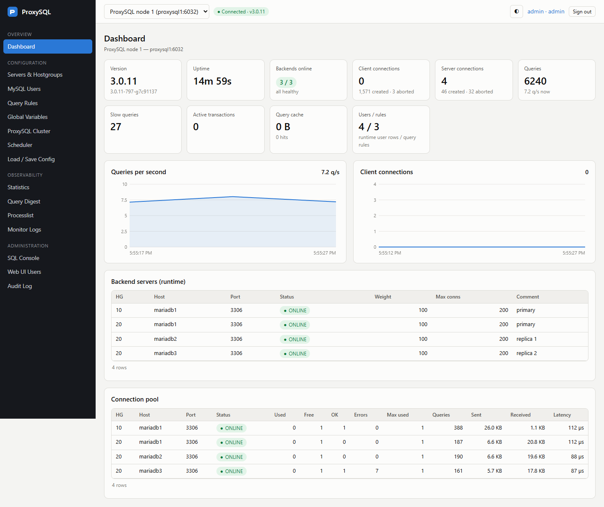
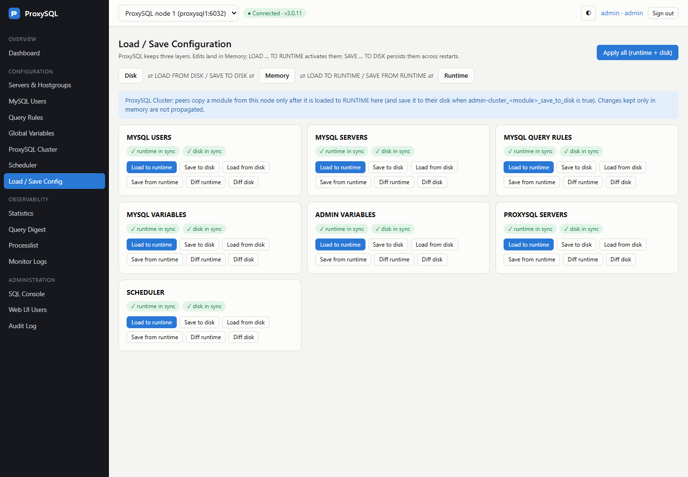
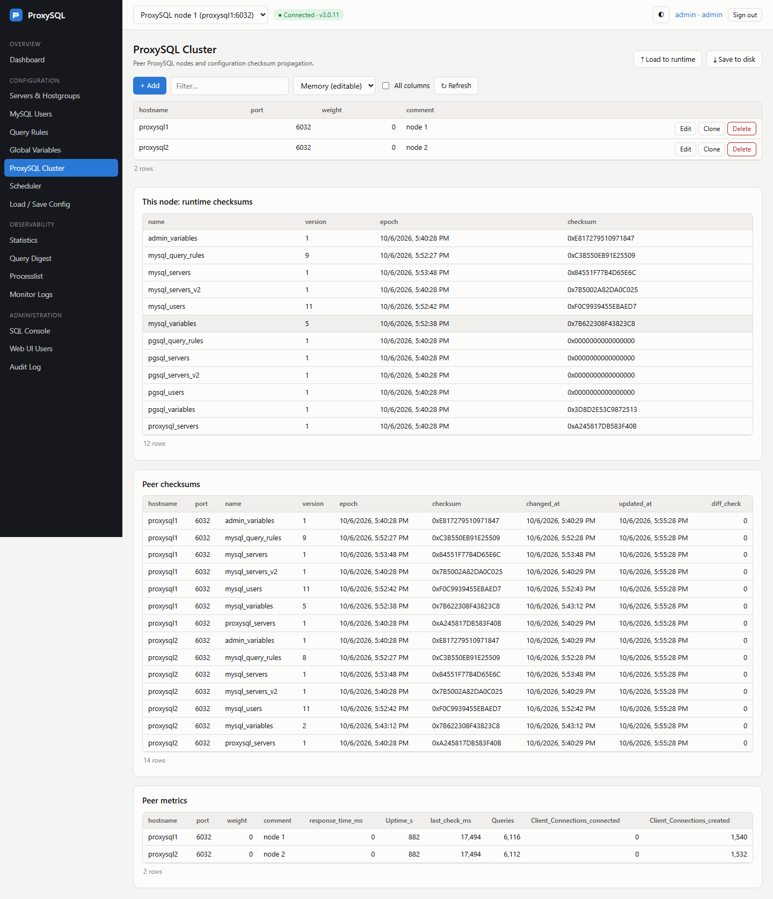
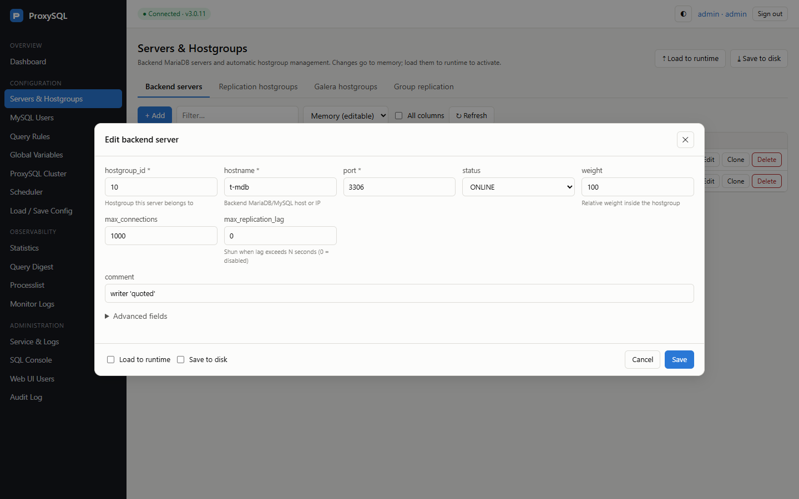
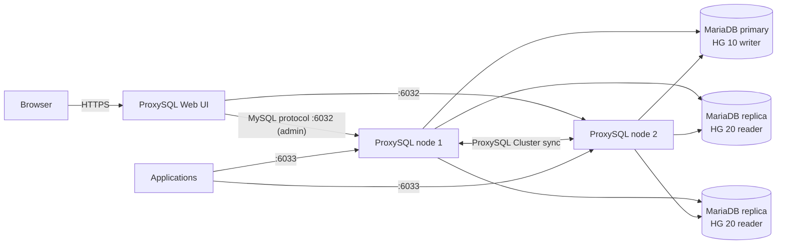

# ProxySQL Web UI

A web interface to **monitor and manage [ProxySQL](https://proxysql.com) in front of MariaDB / MySQL**. You can manage
backend servers, users, query rules and variables, load and save configuration between memory, runtime and disk, follow
a ProxySQL Cluster, watch statistics, and control the ProxySQL service.

- Runs on **Linux** (RHEL 9/10 and derivatives, with an installer; other distributions with manual steps) and on **Windows**
  (natively or with Docker Desktop).
- Talks to the ProxySQL **admin interface** (port 6032) and works with ProxySQL 2.x and 3.x. Tested with ProxySQL 3.0.11 and MariaDB 11.
- One UI manages **several ProxySQL nodes**.
- No external CDN or internet access needed at runtime. Python backend (Flask) and a plain-JavaScript frontend.



---

## Contents

1. [Features](#1-features)
2. [How it works](#2-how-it-works)
3. [Install on Linux](#3-install-on-linux)
4. [Install on Windows](#4-install-on-windows)
5. [Configuration](#5-configuration)
6. [First login and web UI accounts](#6-first-login-and-web-ui-accounts)
7. [Managing ProxySQL servers](#7-managing-proxysql-servers)
8. [Managing MariaDB servers](#8-managing-mariadb-servers)
9. [Monitoring and troubleshooting](#9-monitoring-and-troubleshooting)
10. [Docker test lab](#10-docker-test-lab)
11. [Upgrade and uninstall](#11-upgrade-and-uninstall)
12. [Security](#12-security)
13. [Project layout](#13-project-layout)

---

## 1. Features

| Area | What you can do |
|---|---|
| **Dashboard** | Version, uptime, backends online, client/server connections, live queries-per-second and connection charts, runtime servers, connection pool |
| **Servers & Hostgroups** | Add, edit, clone and delete `mysql_servers`, replication hostgroups (MariaDB async replication), Galera hostgroups (MariaDB Galera Cluster) and group replication |
| **MySQL Users** | Add, edit and delete `mysql_users`. Passwords can be clear text or a `mysql_native_password` hash. Leaving the password empty on edit keeps the current one |
| **Query Rules** | Routing (read/write split), rewrite, cache and mirroring rules. Advanced columns are behind a toggle |
| **Global Variables** | Edit `mysql-*` and `admin-*` variables, with memory, runtime and disk values side by side |
| **Load / Save Config** | `LOAD … TO RUNTIME`, `SAVE … TO DISK`, `LOAD … FROM DISK`, `SAVE … FROM RUNTIME`, a diff between layers, and "Apply all". A header badge shows changes that are not applied yet |
| **ProxySQL Cluster** | Cluster nodes, configuration checksums of this node and its peers, peer metrics |
| **Statistics** | Connection pool, commands, frontend users, backend errors, query rule hits, memory, GTID. Counters can be reset |
| **Query Digest** | Top queries by total time, average time, executions or rows |
| **Processlist / Monitor Logs** | Live sessions; ping, connect, read_only, replication lag and Galera health checks |
| **Service & Logs** (Linux) | `systemctl start / stop / restart proxysql`, unit status, `proxysql.log` and the systemd journal |
| **SQL Console** | Run any statement on the admin interface, with snippets and history |
| **Security** | Roles (viewer / operator / admin), login throttling, CSRF protection, strict CSP, and an audit log of every change |

| Load / Save | ProxySQL Cluster | Edit dialog |
|---|---|---|
|  |  |  |

---

## 2. How it works



- The web UI connects only to the **ProxySQL admin port (6032)**. It never connects to MariaDB directly.
- ProxySQL keeps its configuration in **three layers**. Every edit in the UI goes to **Memory**:

  ```
  DISK (proxysql.db)  ⇄  MEMORY (what you edit)  ⇄  RUNTIME (what is active)
       LOAD … FROM DISK / SAVE … TO DISK     LOAD … TO RUNTIME / SAVE … FROM RUNTIME
  ```

  An edit becomes active only after **Load to runtime**. It survives a ProxySQL restart only after **Save to disk**.
  Each edit dialog has *Load to runtime* and *Save to disk* checkboxes that do both right away.

---

## 3. Install on Linux

### 3.1 Requirements

- A Linux server with systemd and Python **3.9 or newer**. RHEL 9 ships 3.9 and RHEL 10 ships 3.12.
- Network access from this server to the ProxySQL admin port (6032) of every node you want to manage.
- ProxySQL can run on the same host or on other hosts.

### 3.2 RHEL 9 / RHEL 10 / Rocky / AlmaLinux / Oracle Linux (installer)

```bash
sudo dnf -y install git
git clone https://github.com/UtaMarian/ProxySQL.git proxysql-webui
cd proxysql-webui

# ProxySQL on the same host, default admin account:
sudo bash deploy/install.sh

# ...or point it at a ProxySQL node with a remote admin account (see 7.2):
sudo bash deploy/install.sh --admin-host 10.0.0.11 --admin-user radmin --admin-password 'S3cret'
```

The installer:

1. installs `python3`, `python3-pip`, `openssl` and `sudo` with `dnf`,
2. creates the system user `proxysql-webui` and adds it to `systemd-journal` (and to `proxysql` if that group exists),
3. installs the app to `/opt/proxysql-webui` with its own virtualenv (Flask, PyMySQL, gunicorn),
4. writes `/etc/proxysql-webui/config.ini` (with a random session secret), `gunicorn.conf.py` and a **self-signed TLS certificate**,
5. writes `/etc/sudoers.d/proxysql-webui`, which allows **only** `systemctl start|stop|restart proxysql`, `journalctl -u proxysql …`
   and `tail` of `proxysql.log`. The file is validated with `visudo`,
6. installs and starts `proxysql-webui.service`, opens the port in **firewalld** and restores **SELinux** contexts,
7. creates the web UI account **`admin`** with a random password and **prints it**. Note it down.

Open **`https://<server>:8443/`**. Your browser will warn about the self-signed certificate until you install your own (see 5.3).

Installer options:

| Option | Default | Meaning |
|---|---|---|
| `--port N` | `8443` | HTTPS port |
| `--admin-host / --admin-port` | `127.0.0.1` / `6032` | ProxySQL admin endpoint (only used when a new config is written) |
| `--admin-user / --admin-password` | `admin` / `admin` | ProxySQL admin credentials (only used when a new config is written) |
| `--unit NAME` | `proxysql` | ProxySQL systemd unit name |
| `--python PATH` | `/usr/bin/python3` | Interpreter, e.g. `/usr/bin/python3.12` on RHEL 9 |
| `--wheels DIR` | — | Offline install from pre-downloaded wheels |
| `--no-firewall` / `--no-start` | — | Skip firewalld / don't start the service |

Check it:

```bash
systemctl status proxysql-webui
journalctl -u proxysql-webui -f
```

#### Offline (air-gapped) servers

On a machine with internet access and the **same OS major version and Python version**:

```bash
python3 -m pip download -r requirements.txt -d wheels/
```

Copy the repository and `wheels/` to the server, then run `sudo bash deploy/install.sh --wheels ./wheels`.

### 3.3 Debian / Ubuntu / other distributions (manual)

The installer uses `dnf`. On other distributions, run the same steps by hand:

```bash
sudo apt-get install -y python3 python3-venv python3-pip openssl sudo git    # Debian/Ubuntu
git clone https://github.com/UtaMarian/ProxySQL.git proxysql-webui && cd proxysql-webui

sudo useradd --system --home-dir /var/lib/proxysql-webui --shell /usr/sbin/nologin proxysql-webui
sudo usermod -aG systemd-journal proxysql-webui
sudo install -d -m 0755 /opt/proxysql-webui
sudo cp -r app wsgi.py requirements.txt /opt/proxysql-webui/
sudo python3 -m venv /opt/proxysql-webui/venv
sudo /opt/proxysql-webui/venv/bin/pip install -r /opt/proxysql-webui/requirements.txt

sudo install -d -m 0750 -o root -g proxysql-webui /etc/proxysql-webui /etc/proxysql-webui/tls
sudo install -d -m 0750 -o proxysql-webui -g proxysql-webui /var/lib/proxysql-webui
sudo cp deploy/config.ini.example /etc/proxysql-webui/config.ini
sudo cp deploy/gunicorn.conf.py /etc/proxysql-webui/
sudo sed -i "s/^secret_key = .*/secret_key = $(openssl rand -hex 32)/" /etc/proxysql-webui/config.ini
sudo nano /etc/proxysql-webui/config.ini        # set the [instance:...] section(s), see section 5
sudo openssl req -x509 -newkey rsa:3072 -sha256 -days 825 -nodes -subj "/CN=$(hostname -f)" \
     -keyout /etc/proxysql-webui/tls/server.key -out /etc/proxysql-webui/tls/server.crt
sudo chown root:proxysql-webui /etc/proxysql-webui/config.ini /etc/proxysql-webui/gunicorn.conf.py /etc/proxysql-webui/tls/*
sudo chmod 0640 /etc/proxysql-webui/config.ini /etc/proxysql-webui/gunicorn.conf.py /etc/proxysql-webui/tls/server.key

# optional - service control from the UI (adjust the unit name and log path if needed):
echo 'proxysql-webui ALL=(root) NOPASSWD: /usr/bin/systemctl start proxysql, /usr/bin/systemctl stop proxysql, /usr/bin/systemctl restart proxysql, /usr/bin/journalctl -u proxysql --no-pager -n 500 -o short-iso, /usr/bin/tail -n 500 /var/lib/proxysql/proxysql.log' \
  | sudo tee /etc/sudoers.d/proxysql-webui && sudo chmod 0440 /etc/sudoers.d/proxysql-webui && sudo visudo -c

sudo cp deploy/proxysql-webui.service /etc/systemd/system/
sudo systemctl daemon-reload && sudo systemctl enable --now proxysql-webui

# first web UI admin account
cd /opt/proxysql-webui && sudo -u proxysql-webui env PROXYSQL_WEBUI_CONFIG=/etc/proxysql-webui/config.ini \
     venv/bin/python -m app.cli create-user admin --role admin
```

Open the port in your firewall (`ufw allow 8443/tcp` on Ubuntu).

---

## 4. Install on Windows

gunicorn does not run on Windows, so the Windows install uses **waitress** (installed automatically by
`requirements.txt`). Systemd service control is Linux-only, so the *Service & Logs* page is not shown on Windows.
Everything else works the same.

### 4.1 Option A: native install with PowerShell (recommended)

Requirements: Windows 10/11 or Windows Server 2019+, **Python 3.9+** from [python.org](https://www.python.org/downloads/windows/)
(tick *Add python.exe to PATH*), and Git for Windows (or download the repository as a ZIP).

Open **PowerShell as Administrator**:

```powershell
git clone https://github.com/UtaMarian/ProxySQL.git C:\src\proxysql-webui
cd C:\src\proxysql-webui

powershell -ExecutionPolicy Bypass -File deploy\windows\install.ps1 `
    -AdminHost 10.0.0.11 -AdminPort 6032 -AdminUser radmin -AdminPassword 'S3cret' `
    -BindHost 127.0.0.1 -Port 8080
```

The script:

- installs into `C:\ProxySQL-WebUI` (virtualenv, app, `config.ini` readable only by Administrators and SYSTEM, `data\` with the account database and log),
- creates the web UI account **`admin`** with a random password and **prints it**,
- registers the scheduled task **"ProxySQL Web UI"**, which starts the server at boot as SYSTEM and starts it immediately.

Open **http://127.0.0.1:8080/**.

| Parameter | Default | Meaning |
|---|---|---|
| `-InstallDir` | `C:\ProxySQL-WebUI` | Install location |
| `-BindHost` / `-Port` | `127.0.0.1` / `8080` | Listen address. Use `0.0.0.0` to allow other machines (see the HTTPS note below) |
| `-AdminHost/-AdminPort/-AdminUser/-AdminPassword` | `127.0.0.1` / `6032` / `radmin` / `radmin` | First ProxySQL instance |
| `-OpenFirewall` | off | Add an inbound Windows Firewall rule for the port |
| `-NoTask` | off | Don't register the scheduled task |
| `-Python` | `python` | Python executable |

Manage it:

```powershell
Start-ScheduledTask -TaskName "ProxySQL Web UI"
Stop-ScheduledTask  -TaskName "ProxySQL Web UI"
Get-Content C:\ProxySQL-WebUI\data\webui.log -Tail 50 -Wait
```

> **HTTPS on Windows:** waitress serves plain HTTP. Keep `-BindHost 127.0.0.1`, or publish the UI through an HTTPS
> reverse proxy (IIS with ARR/URL Rewrite, or nginx for Windows). When you use a proxy, set `behind_proxy = true` and
> `secure_cookies = true` in `config.ini`.

### 4.2 Option B: manual / development run on Windows

```powershell
cd C:\src\proxysql-webui
python -m venv venv
.\venv\Scripts\pip install -r requirements.txt
copy deploy\config.ini.example config.ini      # edit: data_dir = C:\src\proxysql-webui\data,
                                               #       secure_cookies = false, [service] enabled = false,
                                               #       and the [instance:...] sections
$env:PROXYSQL_WEBUI_CONFIG = "$PWD\config.ini"
.\venv\Scripts\python -m app.cli create-user admin --role admin
.\venv\Scripts\python serve.py --host 127.0.0.1 --port 8080
```

### 4.3 Option C: Docker Desktop

Run only the web UI container against existing ProxySQL servers:

```powershell
cd C:\src\proxysql-webui
docker build -f docker/Dockerfile -t proxysql-webui .
# my-config.ini: same format as docker/webui.ini, with your [instance:...] sections
docker run -d --name proxysql-webui -p 127.0.0.1:8080:8080 `
  -e WEBUI_ADMIN_PASSWORD='ChangeMe-123' `
  -v ${PWD}\my-config.ini:/etc/proxysql-webui/config.ini:ro `
  -v proxysql-webui-data:/var/lib/proxysql-webui proxysql-webui
```

To try everything without existing servers, start the complete lab (3 MariaDB + 2 ProxySQL + UI). See [section 10](#10-docker-test-lab).
Docker on Linux works the same way.

---

## 5. Configuration

Configuration file:

| Platform | Path |
|---|---|
| Linux | `/etc/proxysql-webui/config.ini` (owner `root:proxysql-webui`, mode `0640`) |
| Windows | `C:\ProxySQL-WebUI\config.ini` |
| Any | Set the `PROXYSQL_WEBUI_CONFIG` environment variable to use another path |

After you edit it, restart the UI. On Linux run `sudo systemctl restart proxysql-webui`. On Windows, stop and start the scheduled task.

### 5.1 Reference

```ini
[webui]
secret_key = <random>            ; signs session cookies - keep it secret
data_dir = /var/lib/proxysql-webui
session_lifetime_minutes = 480
secure_cookies = true            ; false only for plain-HTTP setups
max_login_failures = 5           ; per username / client IP ...
lockout_minutes = 15             ; ... within this window
behind_proxy = false             ; true behind nginx/httpd/IIS (trust X-Forwarded-*)

[service]                        ; Linux only
enabled = true                   ; show Service & Logs page
unit = proxysql
log_file = /var/lib/proxysql/proxysql.log
use_sudo = true

[instance:node1]                 ; one section per ProxySQL node, key = "node1"
label = ProxySQL node 1
host = 10.0.0.11
port = 6032
user = radmin
password = S3cret
local = false                    ; true = this node runs on the web UI host
connect_timeout = 5
read_timeout = 30

[instance:node2]
label = ProxySQL node 2
host = 10.0.0.12
port = 6032
user = radmin
password = S3cret
```

### 5.2 Behind nginx / httpd

In `gunicorn.conf.py`, set `bind = "127.0.0.1:8080"` and comment out `certfile` and `keyfile`. In `config.ini`, set
`behind_proxy = true`. Then proxy `https://ui.example.com/` to `http://127.0.0.1:8080/`. On SELinux hosts, also run
`setsebool -P httpd_can_network_connect 1`.

### 5.3 Your own TLS certificate (Linux)

Replace `/etc/proxysql-webui/tls/server.crt` and `server.key` (owner `root:proxysql-webui`, key mode `0640`), then run
`systemctl restart proxysql-webui`.

---

## 6. First login and web UI accounts

Sign in with the `admin` account the installer printed. Then change its password under **My Account** (click your name in the top-right).

| Role | Can |
|---|---|
| `viewer` | See everything except secrets (passwords are masked) |
| `operator` | + edit configuration, load/save, reset statistics, read logs |
| `admin` | + start/stop/restart ProxySQL, SQL console, web UI accounts, audit log |

Manage accounts in the UI under **Administration → Web UI Users**, or from the shell:

```bash
# Linux
sudo proxysql-webui-admin list-users
sudo proxysql-webui-admin create-user alice --role operator
sudo proxysql-webui-admin set-password admin
sudo proxysql-webui-admin set-role alice admin
sudo proxysql-webui-admin unlock               # clear login lockouts
```

```powershell
# Windows (elevated PowerShell)
$env:PROXYSQL_WEBUI_CONFIG = "C:\ProxySQL-WebUI\config.ini"; cd C:\ProxySQL-WebUI
.\venv\Scripts\python -m app.cli set-password admin
```

---

## 7. Managing ProxySQL servers

### 7.1 Install ProxySQL on a node

Follow the official guide: <https://proxysql.com/documentation/installing-proxysql/>. On RHEL, add the ProxySQL
repository, run `dnf install proxysql`, then:

```bash
sudo systemctl enable --now proxysql
mysql -h127.0.0.1 -P6032 -uadmin -padmin --prompt 'ProxySQL Admin> '   # admin interface
```

> Change the default `admin:admin` credentials before you use ProxySQL in production.

### 7.2 Let the web UI connect to a node

ProxySQL's built-in `admin` account **only accepts connections from localhost**. When the web UI runs on another host,
or in Docker, create a second admin account on **each** ProxySQL node:

```sql
-- on the ProxySQL admin interface (port 6032)
UPDATE global_variables SET variable_value = 'admin:admin;radmin:S3cret'
 WHERE variable_name = 'admin-admin_credentials';
LOAD ADMIN VARIABLES TO RUNTIME;
SAVE ADMIN VARIABLES TO DISK;
```

Allow TCP 6032 from the web UI host only, for example `firewall-cmd --permanent --add-rich-rule='rule family=ipv4 source address=10.0.0.5 port port=6032 protocol=tcp accept'`.

Add the node to `config.ini` as a new `[instance:...]` section (see 5.1) and restart the web UI. The node then appears in the
**instance selector** at the top of the page. A green *Connected* label confirms the connection and shows the ProxySQL version.

### 7.3 Everyday workflow

1. Pick the node in the **instance selector**.
2. Make your changes (servers, users, rules, variables). They go to **memory**.
3. Apply them in one of three ways:
   - tick **Load to runtime** and **Save to disk** in the edit dialog,
   - use the **⇡ Load to runtime** / **⤓ Save to disk** buttons at the top of the page,
   - use **Load / Save Config** to apply per module, or **Apply all (runtime + disk)**.
4. A yellow **"⚠ N modules not applied"** badge and dots in the sidebar show what still differs. Use **Diff runtime** or
   **Diff disk** on the Load / Save page to see the exact rows.

Other actions on the Load / Save page:

| Button | Command | Use it to |
|---|---|---|
| Load to runtime | `LOAD <module> TO RUNTIME` | Activate memory changes |
| Save to disk | `SAVE <module> TO DISK` | Persist memory across restarts |
| Load from disk | `LOAD <module> FROM DISK` | **Discard** unsaved memory edits (restore the saved config) |
| Save from runtime | `SAVE <module> FROM RUNTIME` | **Discard** memory edits and copy the active config back to memory |

### 7.4 ProxySQL Cluster (several ProxySQL nodes in sync)

With ProxySQL Cluster, a change you load to runtime on **one** node is copied to all the other nodes automatically: users,
servers, query rules, variables and the node list itself.

**Set it up.** Do this on every node, with the SQL Console or the Global Variables page:

```sql
-- 1. a dedicated account the nodes use to talk to each other (add it to the admin credentials)
UPDATE global_variables SET variable_value = 'admin:admin;radmin:S3cret;cluster:ClusterPass'
 WHERE variable_name = 'admin-admin_credentials';
UPDATE global_variables SET variable_value = 'cluster'     WHERE variable_name = 'admin-cluster_username';
UPDATE global_variables SET variable_value = 'ClusterPass' WHERE variable_name = 'admin-cluster_password';
-- receiving nodes also write what they receive to disk
UPDATE global_variables SET variable_value = 'true' WHERE variable_name IN (
  'admin-cluster_mysql_users_save_to_disk', 'admin-cluster_mysql_servers_save_to_disk',
  'admin-cluster_mysql_query_rules_save_to_disk', 'admin-cluster_mysql_variables_save_to_disk',
  'admin-cluster_admin_variables_save_to_disk', 'admin-cluster_proxysql_servers_save_to_disk');
LOAD ADMIN VARIABLES TO RUNTIME; SAVE ADMIN VARIABLES TO DISK;
```

2. Open **ProxySQL Cluster → + Add** and add every node, including this one, by hostname and admin port (6032).
   Then **Load to runtime** and **Save to disk**. Do this on each node, or on one node once the cluster account is in place everywhere.
3. Check **Peer checksums** on the ProxySQL Cluster page. Every node should report the same checksum per module, and
   `diff_check` should stay at 0.

**How changes spread:**

- A peer copies a module only after it is **loaded to RUNTIME** on the node where you edited it. In our tests this took about 2 seconds.
  Edits kept only in memory are **not** copied.
- The receiving node updates its memory and runtime. It also updates its disk when `admin-cluster_<module>_save_to_disk=true`.
- Edit on any node. The most recent change wins.
- After a sync, ProxySQL stores each MySQL user as two rows (frontend + backend). The UI shows such a pair as **one user**,
  and edit/delete always apply to the whole user.
- Add every node to `config.ini` as an instance, so you can watch each node's dashboard.

### 7.5 Start / stop / restart ProxySQL (Linux)

On **Administration → Service & Logs** (admin role): the unit status, **Start**, **Restart** and **Stop**. Stop and restart
drop every client connection, so the UI asks you to confirm. The log viewer shows the last 500 lines of `proxysql.log` or
the systemd journal, with a filter, an errors-only toggle and follow mode.

This page controls the ProxySQL service **on the web UI host** (the instance marked `local = true`). For remote nodes, use
SSH or your configuration management tool.

---

## 8. Managing MariaDB servers

### 8.1 Prepare each MariaDB server

ProxySQL **does not store a username or password per backend server**. It needs two kinds of accounts on **every** MariaDB server:

| Account | Used for | Where ProxySQL takes it from |
|---|---|---|
| **monitor** | Health checks: ping, connect, `read_only`, replication lag | Global Variables: `mysql-monitor_username` / `mysql-monitor_password` |
| **application users** | Client queries forwarded to the backend | **MySQL Users** page (same username and password as on MariaDB) |

```sql
-- on MariaDB (with replication, run it on the primary and it replicates)
CREATE USER 'monitor'@'%' IDENTIFIED BY 'MonitorPass';
GRANT USAGE, REPLICATION CLIENT, SLAVE MONITOR ON *.* TO 'monitor'@'%';     -- SLAVE MONITOR: MariaDB 10.5+

CREATE USER 'app'@'%' IDENTIFIED BY 'AppPass';
GRANT ALL ON appdb.* TO 'app'@'%';
```

Then, in the web UI, open **Global Variables** and set `mysql-monitor_username` and `mysql-monitor_password` to these
values. Tick **Load to runtime** and **Save to disk**. Use a restricted host (e.g. `'monitor'@'10.0.0.%'`) instead of `%` in production.

### 8.2 Add a backend server

**Servers & Hostgroups → Backend servers → + Add**

| Field | Meaning |
|---|---|
| `hostgroup_id` | Group the server belongs to. Query rules and users point to hostgroups, not to servers. Common layout: **10 = writer**, **20 = readers** |
| `hostname` / `port` | MariaDB address, usually port 3306 |
| `status` | `ONLINE` (in use), `OFFLINE_SOFT` (drain: no new connections), `OFFLINE_HARD` (removed now) |
| `weight` | Share of traffic inside the hostgroup. A server with weight 200 gets twice the traffic of one with weight 100 |
| `max_connections` | Upper limit of ProxySQL→server connections |
| `max_replication_lag` | Shun a replica that lags more than N seconds (0 = off) |

Tick **Load to runtime** and **Save to disk**, then click **Create**. Then check:

- **Dashboard → Backend servers (runtime)** shows the server as **ONLINE**.
- **Monitor Logs → Connect / Ping** shows no errors for it. `Access denied for user 'monitor'` means the monitor account is missing on that server.

### 8.3 Primary + replicas (async replication)

Let ProxySQL find the writer by itself. Open **Servers & Hostgroups → Replication hostgroups → + Add**:

| writer_hostgroup | reader_hostgroup | check_type |
|---|---|---|
| 10 | 20 | `read_only` |

Then set `read_only=1` on every replica (`SET GLOBAL read_only=1;` and `read_only=1` in `my.cnf`). The monitor puts the server
with `read_only=0` in HG 10 and the replicas in HG 20. If you promote a replica to primary and change `read_only` accordingly,
ProxySQL follows automatically. By default the writer also serves reads (`mysql-monitor_writer_is_also_reader`).

> The runtime layer then legitimately differs from memory: servers move between hostgroups 10 and 20. The UI knows this and
> does **not** report these moves as unapplied changes.

### 8.4 MariaDB Galera Cluster

Open **Servers & Hostgroups → Galera hostgroups → + Add**, for example writer `10`, backup writer `11`, reader `20`, offline `30`,
`max_writers = 1`, `writer_is_also_reader = 0` (or 1/2), `active = 1`. Add all Galera nodes to hostgroup 10. The monitor checks
`wsrep_*` status and places the nodes. Then **Load to runtime** and **Save to disk**.

### 8.5 Route queries (read/write split)

**MySQL Users → + Add:** the user `app` with the same password as on MariaDB, `default_hostgroup = 10` (writer).
Then **Query Rules → + Add**:

| rule_id | match_digest | destination_hostgroup | apply | Effect |
|---|---|---|---|---|
| 100 | `^SELECT.*FOR UPDATE` | 10 | yes | Locking reads go to the writer |
| 200 | `^SELECT` | 20 | yes | Other reads go to the replicas |

Everything else (INSERT/UPDATE/DELETE/DDL) uses the user's default hostgroup, 10. Check the result in **Query Digest**: the `hostgroup` column shows where each query type went.
**Statistics → Query rule hits** shows how often each rule matched.

### 8.6 Maintenance: take a server out and bring it back

1. **Drain:** edit the server, set `status = OFFLINE_SOFT`, then Load to runtime. Existing transactions finish, but no new connections go to the server.
   On **Statistics → Connection pool**, wait until `ConnUsed` is 0.
2. Do the maintenance: patch, restart MariaDB, and so on.
3. **Return:** set `status = ONLINE`, then Load to runtime.
4. **Remove permanently:** **Delete** the row, then Load to runtime and Save to disk.

If a server goes down unexpectedly, ProxySQL marks it **SHUNNED** and stops sending traffic to it. When the server is
reachable again, it returns to **ONLINE** automatically. You can watch this on the Dashboard and in **Monitor Logs**.

### 8.7 MySQL users

- Each user must exist **both** in ProxySQL (MySQL Users page) and on the MariaDB backends, with the same password.
- `default_hostgroup`: where the user's queries go when no query rule matches.
- `transaction_persistent = yes` keeps a transaction on one server. Leave it on.
- `max_connections`: limit of client connections for that user through ProxySQL.
- Passwords can be stored in clear text or as a `mysql_native_password` hash (`*HEX…`, checkbox in the dialog). When you
  edit a user, an empty password field keeps the current password.

---

## 9. Monitoring and troubleshooting

| Where | What it tells you |
|---|---|
| **Dashboard** | Health at a glance: backends online, connections, queries per second, connection pool per server |
| **Statistics → Connection pool** | Per server: status, used/free connections, errors, queries, bytes, latency |
| **Statistics → Backend errors** | Errors returned by MariaDB, per server and user (e.g. `Access denied`) |
| **Query Digest** | Slowest and most frequent queries, and which hostgroup served them |
| **Processlist** | Client sessions open right now |
| **Monitor Logs** | Results of the ping / connect / read_only / replication-lag / Galera checks |
| **ProxySQL Cluster** | Whether all nodes hold the same configuration |
| **Service & Logs** | ProxySQL log and journal (Linux) |
| **Audit Log** | Who changed what, and when, through the web UI |

Common problems:

| Symptom | Cause / fix |
|---|---|
| Header shows **✕ Unreachable** | Wrong host/port/credentials in `config.ini`, or the `admin` account is used from a remote host (see 7.2), or a firewall blocks 6032 |
| Server **SHUNNED** | MariaDB is down or unreachable, or replication lag exceeds `max_replication_lag`. Check **Monitor Logs → Ping / Connect** |
| `Access denied for user 'monitor'` in Monitor Logs | The monitor account is missing or has a different password on that MariaDB server (see 8.1) |
| Clients get `Access denied` | The user is missing in **MySQL Users**, its password differs from MariaDB, it is not loaded to runtime, or it is missing on that backend |
| Change has no effect | It is only in memory. Use **Load to runtime** (and the badge in the header) |
| Change lost after a ProxySQL restart | It was not saved. Use **Save to disk** |
| Cluster peer doesn't get a change | It was not loaded to runtime on the source node, or the cluster credentials differ. Check **ProxySQL Cluster → Peer checksums** |
| Login refused after a few attempts | Login lockout. Wait `lockout_minutes`, or run `proxysql-webui-admin unlock` |
| Service page: `sudo: a password is required` | `/etc/sudoers.d/proxysql-webui` is missing, or the unit name / log path in it differs from `config.ini`. Re-run the installer |

Web UI logs: `journalctl -u proxysql-webui -f` on Linux, `C:\ProxySQL-WebUI\data\webui.log` on Windows.

---

## 10. Docker test lab

`docker/` contains a complete, disposable environment to try everything, on Linux or on Windows with Docker Desktop:

- **3 MariaDB 11 servers**: `mariadb1` primary, `mariadb2` and `mariadb3` GTID replicas with `read_only=1`, and a replication hostgroup (10/20),
- **2 ProxySQL nodes** (`proxysql1`, `proxysql2`) in a **ProxySQL Cluster**,
- the **web UI** managing both nodes,
- a **traffic generator** reading and writing through both nodes.

```bash
cd docker
docker compose up -d --build      # start (first build takes a minute)
python tests/scenarios.py         # optional: run the scenario tests
docker compose logs -f webui      # web UI logs
docker compose down -v            # stop and delete all data
```

| What | Address | Credentials |
|---|---|---|
| Web UI | http://localhost:18080 | `admin` / `AdminPass123` |
| proxysql1 | 127.0.0.1:16033 clients · 127.0.0.1:16032 admin | `app` / `apppass` · `radmin` / `radmin` |
| proxysql2 | 127.0.0.1:26033 clients · 127.0.0.1:26032 admin | same |
| MariaDB 1 / 2 / 3 | 127.0.0.1:13306 / 13307 / 13308 | `root` / `rootpass` |

Things to try: stop a replica (`docker compose stop mariadb3`) and watch it become SHUNNED and then come back. Add a user on
node 1, load it to runtime, and see it appear on node 2. Edit a query rule and watch **Query Digest**.

`tests/scenarios.py` checks:

- the memory, runtime and disk layers (all four LOAD/SAVE directions and the apply checkboxes),
- cluster propagation in both directions,
- the read/write split over the 3 backends and replication,
- a replica outage,
- the primary switching to `read_only`.

The *Service & Logs* page is disabled in the lab because the containers have no systemd. All ports are bound to localhost
only, and the passwords are fixed test values. **Do not use the lab configuration in production.**

---

## 11. Upgrade and uninstall

**Linux upgrade:** run `git pull`, then `sudo bash deploy/install.sh`. The configuration, accounts and certificate are kept.

**Linux uninstall:** run `sudo bash deploy/uninstall.sh`. Add `--purge` to also delete `/etc/proxysql-webui`, `/var/lib/proxysql-webui`
and the system user.

**Windows upgrade:** run `git pull`, then run `deploy\windows\install.ps1` again. `config.ini` and `data\` are kept.

**Windows uninstall:**

```powershell
Unregister-ScheduledTask -TaskName "ProxySQL Web UI" -Confirm:$false
Remove-NetFirewallRule -DisplayName "ProxySQL Web UI" -ErrorAction SilentlyContinue
Remove-Item -Recurse -Force C:\ProxySQL-WebUI
```

---

## 12. Security

- **Use HTTPS.** On Linux the installer configures TLS. On Windows, bind to localhost or put an HTTPS reverse proxy in front.
- `config.ini` contains ProxySQL admin credentials. Keep it readable only by the service, as both installers do.
- Use a dedicated ProxySQL admin account for the UI (`radmin`), and allow port 6032 only from the UI host.
- Restrict access to the UI port to your admin networks (firewalld zones / rich rules, Windows Firewall).
- On Linux, the service runs as an unprivileged user. The only root actions it can perform are the exact command lines in
  `/etc/sudoers.d/proxysql-webui`. If you don't need service control, set `[service] enabled = false` and remove that file.
- Give people the lowest role they need. The SQL console is admin-only, and every statement and change is recorded in the **Audit Log**.
- Passwords of web UI accounts are hashed with PBKDF2-SHA256, which works with RHEL FIPS mode.

---

## 13. Project layout

```
app/                    Flask backend
  api.py                REST API: config tables, variables, load/save, diff, stats, monitor, SQL, service
  auth.py               login, roles, CSRF, web UI accounts, audit log API
  proxysql.py           ProxySQL admin client (SQLite-safe quoting)
  schemas.py            editable tables and LOAD/SAVE modules
  service.py            systemd control and logs (Linux)
  cli.py                account management CLI
  static/               single-page frontend (plain JavaScript, no build step)
wsgi.py                 WSGI entry point (gunicorn, Linux)
serve.py                waitress entry point (Windows / any OS)
deploy/
  install.sh            RHEL 9/10 installer          uninstall.sh
  proxysql-webui.service  gunicorn.conf.py  config.ini.example
  windows/install.ps1   Windows installer
docker/                 test lab: compose file, ProxySQL/MariaDB bootstrap, scenario tests
docs/screenshots/       images used in this README
```

### Development

```bash
python3 -m venv venv && . venv/bin/activate && pip install -r requirements.txt
cp deploy/config.ini.example dev.ini   # set data_dir = ./data, secure_cookies = false, [service] enabled = false
export PROXYSQL_WEBUI_CONFIG=$PWD/dev.ini
python -m app.cli create-user admin --role admin
flask --app wsgi run --port 8080      # Windows: python serve.py --port 8080
```
